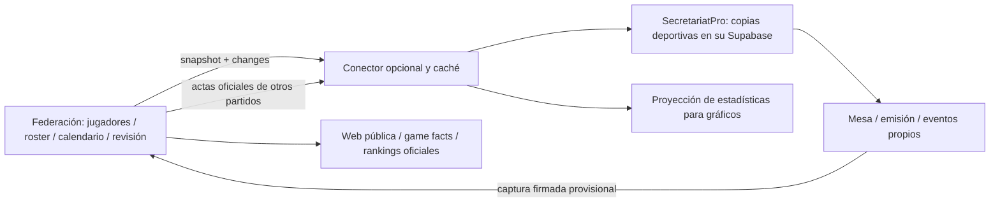

# Sports Exchange v1 — integración opcional entre productos independientes

Este contrato es propio, publicado y versionado. No es una norma federativa ni depende de AEUF, Astro, Supabase o del formato interno de SecretariatPro. El vocabulario deportivo inicial cubre competiciones, equipos, rosters por temporada, convocatorias, goles, asistencias, sanciones y portería. Un deporte que necesite otros eventos requiere ampliar capacidades/versionar el contrato; no debe reinterpretar un campo existente.

## Conectar desde la interfaz (recomendado)

El cliente ya no necesita editar `SP_FEDERATION_CONNECTIONS` ni archivos de configuración.

1. En la web federativa: **Gestión → Integraciones → Invita a SecretariatPro u otro proveedor**. Elegir competición y permiso para enviar jugadas; crear y copiar la invitación.
2. En Manager: seleccionar el espacio correcto, por ejemplo **Asociación de pruebas · Sandbox**, y abrir **Federaciones → Conectar federación**.
3. Pegar la invitación y pulsar **Verificar invitación**. Se muestran nombres de competiciones y el espacio de destino, sin pedir IDs técnicos.
4. Elegir competición y opciones; pulsar **Conectar competición**. Manager guarda la conexión para Manager y Live y descarga el catálogo cuando hay red.
5. La copia de jugadores, rosters y calendario se crea y actualiza automáticamente cada cinco segundos con Manager conectado y permisos vigentes. No hay un paso de importar. Desde el mismo panel se puede **Desconectar / Volver a conectar**; la federación también puede **Revocar acceso**.

Las invitaciones caducan en 15 minutos, sirven para un solo ordenador y deben tratarse como credenciales. El intercambio usa un ID de canje persistente para recuperar una respuesta perdida sin emitir otra credencial. La prueba de invitación no la consume; la confirmación la canjea. Los tickets temporales quedan ligados a la cuenta y al workspace de Manager. No se concede acceso a otros espacios. Al confirmar la conexión se autoriza la actualización automática del catálogo en el espacio elegido.

Manager guarda perfiles y tickets cifrados con Fernet en el directorio privado `federation_exchange/`, con permisos locales restringidos. Su clave `connection-settings.key` debe conservarse con `connection-settings.sqlite` en una copia privada. No se guardan claves en el navegador ni se devuelven en listados de conexión. Una cuenta de sistema operativo comprometida puede leer ese almacén; no se presenta como un llavero ligado al hardware.

La web cifra los secretos de proveedor con AES-256-GCM. En la instalación local su clave queda en `.data/exchange-key.bin` y se incluye en los respaldos privados. Un alojamiento con PostgreSQL remoto debe provisionar una clave estable en su almacén de secretos; esa tarea de despliegue no corresponde al cliente de Manager.

El mecanismo opcional `invitation-code-v1` utiliza `SX1.` seguido de JSON base64url `{v:1,url,token}`. La URL es el origen federativo HTTPS (o loopback de desarrollo); el token tiene 256 bits y solo su hash queda en base. Los endpoints son `POST /api/exchange/v1/invitations/inspect` y `POST /api/exchange/v1/enroll`; este último requiere el token y un `redemptionId` UUID estable. La respuesta de canje entrega las credenciales al proceso nativo, nunca al JavaScript del navegador de Manager. La creación y revocación en AEUF requieren administración autenticada y protección de origen.

La configuración por entorno se conserva para instalaciones técnicas anteriores; no es el recorrido del cliente.

## Responsabilidades

- La federación es el origen de la identidad deportiva de jugadores, equipos, rosters y calendario. Un jugador recibido no es una cuenta de acceso a SecretariatPro. No se envían contraseñas, roles, invitaciones ni correos.
- SecretariatPro conserva su aplicación, sus cuentas, Supabase, captura de mesa, gráficos y datos locales. Sus registros de mesa no se sustituyen con el acta revisada por una federación.
- Cada federación conserva su política de publicación. AEUF exige confirmación local y validación de asociación. El contrato transporta `provisional`, `confirmed`, `official`, sin obligar a otras federaciones a seguir los mismos pasos.
- La conexión importa una copia deportiva desde la federación y publica instantáneas provisionales de la mesa. Cada producto continúa funcionando si se desconecta el otro.



## API federativa implementada en AEUF

| Operación | Función |
|---|---|
| `GET /api/exchange/v1/capabilities` | Contrato, identidad de federación, recursos y autenticación. Público, sin datos privados. |
| `GET /api/exchange/v1/snapshot?competition=ID` | Copia consistente y cursor de una competición autorizada. |
| `GET /api/exchange/v1/changes?competition=ID&after=CURSOR` | Hasta 100 cambios por página, ordenados por cursor; continuar si `hasMore`. |
| `POST /api/exchange/v1/captures` | Recibe una instantánea de mesa. Nunca crea jugadores ni la hace oficial. |

El contrato exacto está en [sports-exchange-openapi.json](../public/downloads/sports-exchange-openapi.json), que se regenera con `npm run exchange:contract`. Los tipos de entidad usan `{kind,id,revision,data}`. Los IDs son opacos, pertenecen al `namespace` federativo y no se comparan por similitud de nombre.

Una captura utiliza identidades **de destino**: `namespace` federativo, `matchId`, `revision` creciente del productor y `match`. Este último contiene identidad de equipos, marcador, estado/reloj/periodo y `report` con convocatoria, eventos y porteros. El adaptador de SecretariatPro traduce sus UUID locales a los IDs federativos vinculados.

Puede enviarse JSON directo o un CloudEvent estructurado con `specversion: "1.0"`, `id` igual al identificador de entrega, `source` igual al namespace autorizado del proveedor, `type: "sports.match.capture.v1"`, `subject` igual al partido y `data` igual a la captura. CloudEvents normaliza el envoltorio, no el significado deportivo.

## Autenticación y separación

Cada conexión tiene una identidad, secreto propio, namespace de proveedor, competiciones y operaciones autorizadas. No se comparte ninguna clave Supabase entre productos.

Cabeceras: `X-Exchange-Client`, `X-Exchange-Timestamp` (Unix segundos), `X-Exchange-Delivery` y `X-Exchange-Signature` (HMAC-SHA256 hexadecimal). Mensaje firmado, unido con saltos de línea:

```text
timestamp
delivery
METHOD
pathnameAndQuery exactos
SHA256 del cuerpo exacto, hexadecimal
```

Se exige secreto de al menos 32 caracteres y ventana de cinco minutos. El cliente exige HTTPS excepto loopback y no sigue redirecciones. HMAC es la autenticación implementada; OAuth no se anuncia como disponible. Puede incorporarse posteriormente en un gateway con la misma autorización y sin cambiar los DTO deportivos.

En AEUF, configuración privada `.env`:

```dotenv
SPORTS_EXCHANGE_NAMESPACE=aeuf.es
SPORTS_EXCHANGE_CONNECTIONS=[{"id":"mesa-sp","namespace":"urn:exchange-client:mesa-sp","secretEnv":"SPORTS_DESK_SECRET","competitions":["ID_COMPETICION_AEUF"],"scopes":["catalog:read","captures:write"]}]
# SPORTS_DESK_SECRET se introduce localmente; no usar una clave de Supabase.
```

Desactivar una conexión o rotar su secreto revoca esa relación y conserva el historial. La configuración se carga en servidor; no se entrega al JavaScript público.

## Qué incorpora SecretariatPro

`secretariat_core/exchange/client.py` es el cliente genérico de biblioteca estándar, independiente de Supabase y AEUF. `federation.py` adapta ese contrato a Live/Manager. El código no incorpora una URL AEUF fija ni exige que la otra federación use esta web.

Las conexiones se crean desde el asistente de Manager. Para instalaciones técnicas anteriores se conserva `SP_FEDERATION_CONNECTIONS` y el ejemplo desactivado de `docs/federation-connections.example.json`; no forma parte del recorrido normal del cliente.

En Manager aparece **Federaciones**:

1. Estado de actualización automática y última aplicación correcta.
2. Ver catálogo conectado: muestra competición, temporada y cantidades.
3. Actualizar ahora (opcional) y Desconectar / Volver a conectar. La actualización utiliza el cliente Supabase de la sesión vigente y sus RLS; no utiliza `service_role` ni introduce políticas nuevas.

Los IDs de copia son UUID deterministas por `workspace + federation namespace + kind + externalId`. Los reintentos reutilizan la misma identidad; dos federaciones pueden usar el mismo ID externo. Dos jugadores con igual nombre no se fusionan. La correspondencia se conserva en SQLite; si se vuelve a importar, los UUID deterministas permiten recuperar las mismas copias.

Las fichas y rosters federativos importados son de consulta mientras la conexión está activa; se corrigen en origen. Los colores, banderas, fotos de producción, temas y OBS siguen siendo locales. El importador no mete actas ajenas en `match_events`: los otros partidos alimentan una proyección separada. El calendario recibido actualiza datos de programación; no sustituye el resultado que está capturando la mesa.

Las conexiones creadas desde Manager actualizan el catálogo automáticamente desde la primera conexión y también al volver a iniciar sesión, incluidas las conexiones guardadas por la versión anterior. No se edita código ni se pulsa Importar. Las configuraciones técnicas antiguas por entorno conservan su opción explícita `autoImport`. Manager registra una sesión con permisos de gestión en el espacio elegido; la copia se consulta cada cinco segundos y solo se aplica si cambia el catálogo. Cerrar sesión o cambiar de espacio impide nuevas escrituras de esa sesión.

El catálogo se aplica mediante operaciones RLS existentes, no mediante una transacción remota única. Una huella persistente se marca como aplicada solo al completar todas las operaciones. Los errores se aíslan por registro, se muestran como pendientes y se reintentan incluso si el cursor ya había descargado los cambios. Una ficha inválida no impide actualizar otros jugadores o el calendario. Su roster dependiente no se sustituye con datos incompletos. Cada entidad válida tiene su propia huella persistente y no se reescribe en cada reintento. Un diario local conserva las marcas de capitán durante una actualización de roster interrumpida. Las escrituras de roster siguen siendo varias operaciones remotas, no una transacción única; una interrupción intermedia se declara parcial y se recupera al reintentar. Los UUID deterministas recuperan una copia parcial sin duplicados. Los cambios de goles o reloj no reescriben el catálogo; los cambios personales tampoco desactivan rosters sin cambios deportivos. Los datos locales no vinculados no se sustituyen por nombre.

Las fichas privadas de AEUF recogen nombre, apellidos, nombre deportivo, fecha de nacimiento, nacionalidad, posición y etiqueta de entrenador; el dorsal pertenece a cada roster. El roster firmado incorpora opcionalmente `firstName`, `lastName`, `birthDate` (ISO o null), `nationality` e `isCoach`. Las extensiones son opcionales y se negocian: `capabilities.features` anuncia `player-details-v1`; el cliente pide `features=player-details-v1` en snapshot/changes. Sin esa petición se mantienen exactamente los cuatro campos originales del jugador (`id`, `name`, `number`, `position`), para que clientes v1 estrictos no fallen por campos nuevos. El SDK guarda las capacidades y vuelve a descargar una instantánea al activar una función nueva, sin perder su cola. Un proveedor anterior sin esa función sigue funcionando con el catálogo básico. Las fechas y apellidos desconocidos no se inventan. No se publican nacimiento o nacionalidad en actas, SSE o fichas públicas. En SecretariatPro se emplean los campos existentes y las posiciones `goalkeeper`, `defender`, `centre`, `forward`, `unknown`; «Centro» y el alias anterior `midfielder` se convierten a `centre`. No se altera la restricción SQL de la beta.

Los endpoints locales nuevos de Manager son `/api/integrations/federations`, `/{id}/sync`, `/{id}/preview`, `/{id}/import` y `/api/exchange/v1/snapshot?connection=ID` para exportar la copia JSON. Conservan Host/Origin, autenticación local, membresía y permisos existentes. **No hay que publicar el puerto de Live/Manager en Internet.** El conector realiza conexiones salientes al servidor federativo.

## Idiomas y datos de federaciones extranjeras

Manager utiliza español, inglés, sueco, checo, finés y alemán también en Federaciones: asistente, estado, catálogo, avisos y errores de conexión. El catálogo `manager_app/federation-i18n.js` contiene las traducciones; los valores interpolados de nombres, competiciones e IDs se conservan. Cambiar el idioma no cambia las identidades, el idioma de la base ni las fechas almacenadas.

SecretariatPro no inspecciona ni adivina columnas de una base remota. El adaptador del proveedor expone el contrato estable, cualquiera que sea su esquema:

| Campo en la federación (ejemplo) | API común | SecretariatPro |
| --- | --- | --- |
| `födelsedatum`, `syntymäaika`, `fecha_nacimiento` | `birthDate`, ISO `YYYY-MM-DD` | `players.birth_date` |
| `förnamn`, `Vorname`, `nombre` | `firstName` | `players.first_name` |
| `efternamn`, `Nachname`, `apellidos` | `lastName` | `players.last_name` |
| Posición «målvakt», «brankář», «Torhüter» | preferentemente `goalkeeper` | `players.position = goalkeeper` |

Los nombres Unicode se conservan. El adaptador nativo reconoce equivalencias de posición explícitas de los seis idiomas, además de códigos canónicos, espacios y mayúsculas; no emplea traducción automática para inferir identidades. Una posición desconocida se guarda como `unknown` con aviso. Las fechas imposibles, identidades contradictorias y dorsales conflictivos quedan pendientes; no se inventan ni se fusionan por nombre. Los campos opcionales omitidos por un proveedor anterior no borran una identidad local más completa. Las diferencias estructurales se resuelven una vez en el adaptador de la federación; no se exige editar código al usuario de Manager.

## Directo, revisión y recuperación

Live despierta un worker tras los cambios de estado y acciones persistidas. El worker prepara únicamente campos deportivos, encola la instantánea y hace red fuera de la interfaz/BroadcastFlow. Manager también notifica altas, anulaciones, importaciones y cierre de acta. El envío ocurre durante el partido; cerrar mesa no es requisito.

El adaptador respeta convocatoria y relaciona las filas separadas de gol/asistencia de SecretariatPro. Mantiene los IDs de evento; una anulación se expresa como la nueva instantánea completa sin esa jugada. Conserva `source_clock`: no inventa minutos acumulados ni periodos históricos ausentes. Las estadísticas reales de portería pueden transportarse por el contrato; la mesa actual no las fabrica si no se han capturado.

SQLite conserva entregas, revisión, hash, correspondencias, cursor y última sincronización. No guarda secretos. En fallos de red se mantiene el último catálogo; al reconectar se reintenta la misma entrega/cuerpo. No se promete entrega exactamente una vez en la red: la recepción idempotente evita duplicar su efecto. El bootstrap y su cursor se obtienen en una transacción consistente. Incluye los checkpoints propios de la conexión para recuperar la revisión de envío si se reconstruye su caché en otro ordenador.

En AEUF se conserva la captura original y el recibo, incluso si la recepción queda congelada. `review_pending`, `official_locked` y `manual_capture` son estados de publicación: `deskMayContinue: true`. Una revisión oficial nunca modifica o detiene la mesa de origen. Al reabrir recepción, el feed despierta la republicación de la última instantánea aunque no haya otro gol.

AEUF reserva un único proveedor por partido. Administración puede cambiarlo en **Integraciones → Proveedores de mesa** sin borrar los recibos anteriores. La primera captura puede reservar el proveedor si no hay uno elegido. Abrir manualmente el acta sigue requiriendo el rol local; cambiar proveedor no elimina una validación oficial. El endpoint antiguo `/api/secretariatpro` se conserva para compatibilidad y no sobrescribe partidos reservados al conector nuevo.

Los gráficos pueden consultar la proyección federativa de la competición vinculada. Por defecto sus totales externos usan actas oficiales. Live puede sustituir la entrada del partido actual por su captura provisional, una sola vez, sin sumarla a su versión en caché. Si la conexión está desactivada, siguen las lecturas independientes anteriores. Una caída de Internet conserva caché/cola; la pantalla de Federaciones indica entregas pendientes y último recibo.

## Emisión sin realizador asignado

`broadcast_enabled=true` y `assigned_to=null` son estados válidos e independientes. Manager permite programar la emisión y dejar el realizador pendiente. Las cadenas vacías se normalizan a `null` al crear/editar; no se envía `""` a una columna UUID. El importador federativo tampoco asigna personas automáticamente. Los propietarios y gestores mantienen su acceso; un realizador con permisos limitados a partidos asignados sigue necesitando asignación antes de operar ese partido. No se amplían sus permisos por estar la emisión programada.

## Supabase y estado de entrega

La base `SecretariatPRO` conectada al plugin sigue siendo la base interna de SecretariatPro. Se ha consultado su estructura para confirmar `assigned_to` nullable y `broadcast_enabled` independiente. No se han ejecutado migraciones ni alterado datos reales, RLS, cuentas o claves de ese proyecto. El acceso interno existente a su Data API sigue vigente. La API deportiva se añade en el límite entre productos; no obliga a migrar de proveedor de base.

AEUF continúa con su base local y migraciones aditivas de recibos/reserva de productor. Para mesas remotas debe alojarse su API en un servidor accesible y con HTTPS. La integración nativa está en el código local de ambos proyectos; no se han reemplazado instaladores estables ni publicado nuevos releases. La aceptación de Windows/Intel, instalado, OBS y cámaras sigue siendo necesaria antes de distribuir una beta nueva.

## Verificación reproducible

- AEUF: `npm test`, `npm run build`, `npm run test:e2e`, `npm run test:exchange`.
- SecretariatPro: `.venv/bin/python packaging/run_regressions.py`, sintaxis JS y suites Node de AGENTS; `npm ci --prefix security_tests` y `npm test --prefix security_tests`.
- La prueba `test:exchange` cruza el cliente nativo Python con el servidor Astro compilado por HTTP. Usa bases temporales, cuentas sintéticas y un transporte Supabase simulado; no escribe sobre el proyecto real.

Referencias de formato: [OpenAPI](https://learn.openapis.org/introduction.html), [CloudEvents](https://cloudevents.io/), [Supabase Data API y seguridad](https://supabase.com/docs/guides/api/securing-your-api). Estos estándares no sustituyen las reglas de identidad, revisión y conflicto definidas aquí.
